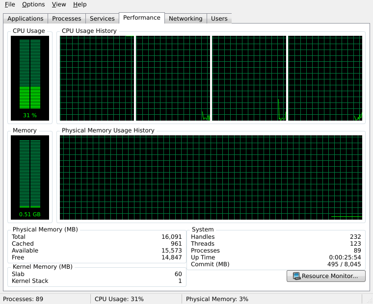
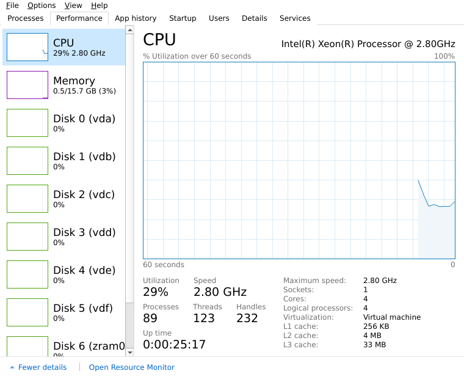
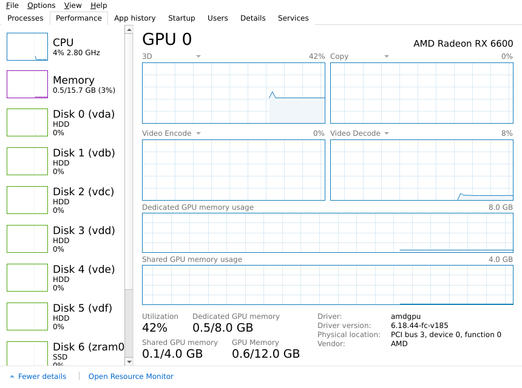

# Task Manager for UNIX

A Task Manager for Linux, macOS and the BSDs that recreates three Windows
layouts:

* **Windows 7**: Applications, Processes, Services, Performance, Networking
  and Users tabs, the black and green CPU/memory meters and history graphs,
  and the status bar.
* **Windows 8**: the *Fewer details* compact view, plus the full view with
  Processes, Performance, App history, Startup, Users, Details and Services
  tabs. It includes the yellow-to-orange heat map, the two-line `12% CPU`
  column headers, and the Performance sidebar with mini graphs.
* **Windows 10**: the Windows 8 layout plus everything Windows 10 added,
  including GPU monitoring and the Power usage columns (listed below).

You can switch layouts at any time from the *View* menu. The app remembers
the last layout you used.

| Windows 7 | Windows 8 |
|---|---|
|  |  |



*The Windows 10 GPU page. The screenshot machine has no GPU, so it was
taken with simulated GPU data.*

## Running

```bash
pip install -r requirements.txt
python3 -m taskmanager            # last used layout (Windows 8 on first start)
python3 -m taskmanager --win7     # Windows 7 layout
python3 -m taskmanager --win8     # Windows 8 layout
python3 -m taskmanager --win10    # Windows 10 layout
```

You can also switch from *View > Layout* in any layout.

Or install it, which adds a `taskmanager` command, and optionally add the
launcher entry:

```bash
pip install .
cp data/taskmanager.desktop ~/.local/share/applications/
```

Requirements: Python 3.8+, [psutil](https://github.com/giampaolo/psutil), and
PySide6 (or PyQt6, which is used automatically if PySide6 is missing).

## Features

### Shared by both layouts

* **Processes:** End process, End process tree, Suspend/Resume, Set priority
  (the Windows priority classes map to nice values from -20 to 19), Set
  affinity (Linux and FreeBSD), Open file location, and a Properties dialog.
* **Services:** systemd units on Linux and launchd jobs on macOS, with
  Start/Stop/Restart. When Task Manager isn't running as root, these go
  through `pkexec`.
* **Run new task:** File > Run new task. It opens programs, documents, folders
  and URLs, and can start the task with administrative privileges (`pkexec`
  or `sudo`).
* **Options:** Always on top, Minimize on use, Hide when minimized (to the
  tray icon, which shows a live CPU meter), and the update speeds High
  (0.5 s), Normal (1 s), Low (4 s) and Paused. F5 refreshes immediately.

### Windows 7 layout

* **Applications:** top-level windows (via `wmctrl` on X11) or running
  desktop apps, with End Task, Switch To and New Task.
* **Processes:** *Show processes from all users*, and *View > Select
  Columns* (PID, CPU Time, Working Set, Threads, Base Priority, I/O, Image
  Path, Command Line and more).
* **Performance:** LED meters, a CPU history graph for each CPU or one for
  all CPUs, *Show Kernel Times* (drawn in red), Physical Memory / Kernel
  Memory / System counters, and a *Resource Monitor...* button that opens the
  desktop's system monitor.
* **Networking:** an auto-scaling utilization graph for each adapter, plus
  the adapter table.
* **Users:** login sessions, with Logoff and Send Message (`write(1)`).

### Windows 8 layout

* **Processes:** grouped into *Apps*, *Background processes* and *System
  processes*. An app expands to show its child processes. You can turn
  grouping off with *Group by type*, and show more columns by right-clicking
  the header.
* **Performance:** CPU, Memory, every disk and every active network adapter.
  The pages include:
  * CPU: *Change graph to > Logical processors*, plus cache sizes, sockets,
    cores and virtualization.
  * Memory: the *Memory composition* bar.
  * Disk: active time, response time and transfer-rate graphs.
  * Network: throughput.

  Double-click the sidebar for the summary view. Right-click a page and pick
  *Copy* to copy its stats as text.
* **App history:** CPU time and disk I/O for each app, collected while Task
  Manager runs and saved to `~/.local/share/taskmanager/app_history.json`.
  *Delete usage history* clears it.
* **Startup:** XDG autostart entries. Enable/Disable writes a per-user
  override file (`Hidden=true`), as the XDG specification describes. On macOS
  the LaunchAgents are listed but can't be changed.
* **Users:** each user's processes and resource usage, with Disconnect /
  Sign out.
* **Details:** the flat process table, with *Select columns*, Set
  priority/affinity, and *Go to service(s)*.

### Windows 10 layout

Everything in the Windows 8 layout, plus:

* **Processes:** *GPU* and *GPU engine* columns (e.g. `GPU 0 - 3D`), and
  *Power usage* and *Power usage trend* (Very low to Very high). The GPU
  column header shows overall GPU use.
* **Performance:**
  * A page for each GPU, with four engine graphs (each graph has a dropdown
    to pick its engine: 3D, Copy, Video Encode, Video Decode, Compute and so
    on). It also has dedicated and shared GPU memory graphs, and the driver,
    driver version and physical location (`PCI bus 3, device 0, function 0`).
  * CPU *Base speed*.
  * Memory: *In use (Compressed)*, plus Speed, Slots used, Form factor and
    Hardware reserved.
  * Disk type (SSD/HDD/Removable) in the sidebar and on the disk page.
  * Wi-Fi SSID and signal strength.
  * Right-click the sidebar to *Hide graphs*.
* **Startup:** *Last BIOS time* (firmware time from `systemd-analyze`), and
  *Startup type* and *Running now* columns.
* **Users:** GPU columns.
* **Details:** *Architecture* (read from the executable's ELF or Mach-O
  header), *Elevated*, *GPU*, *GPU engine*, and *Dedicated* and *Shared GPU
  memory*.
* **Options:** *Set default tab*, *Show full account name* (`Full Name (user)`
  on the Users tab), and *Show history for all processes* on the App history
  tab.

## How Windows concepts map to UNIX

| Windows | This implementation |
|---|---|
| App (has a window) | Process that matches a `.desktop` entry, or a macOS `.app` bundle, and is owned by you |
| Windows processes | Kernel threads, root-owned processes and system accounts (UID < 1000, or < 500 on macOS) |
| Memory (private working set) | RSS minus shared pages |
| Handles | System-wide allocated file handles (`/proc/sys/fs/file-nr`, `kern.num_files`) |
| Paged / non-paged pool | Kernel slab / kernel stack (`/proc/meminfo`) |
| Commit charge | `Committed_AS` / `CommitLimit` |
| Priority classes | nice values (Realtime -20, High -10, Above normal -5, Normal 0, Below normal 5, Low 19) |
| GPU usage per process | DRM client stats in `/proc/<pid>/fdinfo` (Linux 5.19+: amdgpu, i915, xe, msm, panfrost, ...). A process' GPU % is its busiest engine, as on Windows |
| GPU totals | `gpu_busy_percent` / `mem_info_*` in sysfs (amdgpu), or `nvidia-smi` |
| Power usage | An estimate from CPU, GPU and disk activity (Windows estimates it too). Power usage trend averages it over about 2 minutes |
| Elevated | Running with effective UID 0 |
| Last BIOS time | The firmware time reported by `systemd-analyze` |
| RAM speed / slots / form factor | SMBIOS type 17 tables in `/sys/firmware/dmi`; these need root, otherwise they show N/A |

UNIX doesn't report network usage per process without packet capture, so the
per-process *Network* column shows `–` in the Windows 8 and 10 layouts. With NVIDIA's proprietary
driver, GPU use is shown per device only (from `nvidia-smi`), because that
driver doesn't publish per-process statistics in `fdinfo`. The header still shows
overall network utilization. Adapters that don't report a link speed are
measured against 1 Gbps.

## Development

```bash
pip install -e .[test]
QT_QPA_PLATFORM=offscreen pytest
```

The code is split into a few parts:

* `taskmanager/backend/`: everything that talks to the OS. It has no Qt
  dependency, so it can be unit-tested on its own.
* `taskmanager/core.py`: the background sampling thread.
* `taskmanager/widgets/`: the painted graphs and meters, plus the dialogs and
  Services panel that both layouts share.
* `taskmanager/win7/`, `taskmanager/win8/` and `taskmanager/win10/`: one
  package per layout. The Windows 10 window builds on the Windows 8 one, with
  `win10=True` switching on the extra columns and pages.

## License

[WTFPL](LICENSE): do what the fuck you want to.
